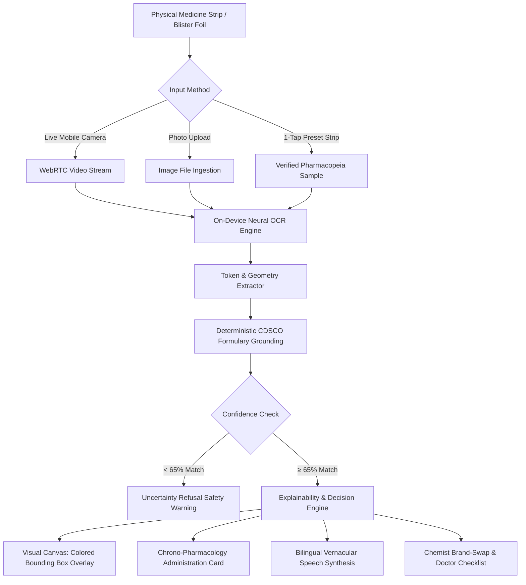

# 💊 Aushadhi Lens (औषधि लेंस)
### Multimodal Medication Safety & Decision-Support Assistant

[](https://kodekurrent.ieeergipt.in/)
[](#-responsible-ai--governance)
[](https://react.dev/)
[](https://tailwindcss.com/)
[](./Aushadhi-Lens.apk)
[](LICENSE)

> **Transforming unreadable medicine packaging into explainable, voice-guided safety decisions for everyday Indian households—with 100% on-device privacy.**

---

## 📌 Problem Overview

In Indian households, non-clinical caregivers and elderly patients managing chronic illnesses (diabetes, hypertension, fever, pain) face three high-stakes hurdles daily:

1. **Unreadable Fine Print:** Blister packs use 6-point shiny, reflective fonts that are nearly impossible for elderly eyes to read.
2. **Chemist Brand Substitutions:** Local medical stores routinely swap prescribed brands for alternative generics (*"Dolo nahi hai, Calpol le lo"*, *"Combiflam nahi hai, Ibufyl Plus le lo"*), creating fear and confusion: *"Is this the same active medicine?"*
3. **Dangerous Administration Errors:** Lack of clarity on meal timings (empty stomach vs. post-meal) and unintentional multi-drug overlaps cause thousands of preventable adverse drug events annually.

### The Specific User Decision
> *"Did the chemist give me the safe, exact active salt? When and how should I take this dose without food/drug conflicts? What specific questions must I clarify with my doctor?"*

---

## 🌟 Key Features

### 1. 📸 Multimodal Visual Ingestion & Neural OCR
* **Live Camera Stream & Upload:** Point your phone camera or upload any physical blister pack photo.
* **Explainable Visual Evidence Canvas:** Projects interactive, color-coded bounding boxes directly onto the original physical packaging image:
  * 🟢 **Active Salt Identification** (e.g., *Ibuprofen 400mg + Paracetamol 325mg*)
  * 🔵 **Brand Identifier** (e.g., *Ibufyl Plus / Dolo-650*)
  * 🟡 **Batch & Expiry Stamp** (e.g., *B.No. SP503F | EXP. 05/2027*)
* **1-Tap Demo Samples:** Includes pre-loaded high-resolution blister packs for instant demonstration:
  * **Ibufyl Plus** (Painkiller & Anti-inflammatory)
  * **Dolo 650** (Fever & Pain)
  * **Pantocid 40** (Acidity & GERD)
  * **Glycomet 500** (Type 2 Diabetes)
  * **Augmentin 625** (Broad-Spectrum Antibiotic)
  * **Cetzine 10** (Antihistamine / Allergy)

### 2. 🔊 Spoken Vernacular Guidance (Audio Accessibility)
* Built-in natural voice synthesis in **conversational Hindi (`hi-IN`) and English (`en-IN`)**.
* Visualized through a live animated audio waveform.
* Example Spoken Hindi:  
  > *"यह इबुफिल प्लस है, जिसमें इबुप्रोफेन और पैरासिटामोल है। यह दर्द और सूजन कम करने की दवा है। इसे हमेशा खाना खाने के बाद या दूध के साथ लें, खाली पेट कभी न लें।"*

### 3. ⏰ Chrono-Pharmacology Administration Rules
* Clear, unmistakable visual badges showing exact meal relation:
  * **EMPTY STOMACH (30–40 min before breakfast):** For PPIs like Pantoprazole.
  * **WITH OR AFTER MEALS:** For NSAIDs/Painkillers (Ibufyl Plus) and Metformin to prevent gastric irritation.
  * **BEDTIME / NIGHT:** For sedating antihistamines (Cetirizine).

### 4. 🔄 Chemist Brand-Swap Auditor
* An interactive matrix to compare **Doctor's Prescribed Brand** vs. **Chemist's Proposed Generic**.
* Algorithmic bioequivalence check: confirms identical active pharmaceutical ingredients (APIs), flags strength mismatches, and displays estimated generic cost savings (e.g., ₹38.80 vs ₹14 — save 64%).

### 5. 🕒 24-Hour Medication Routine
* Automatically slots user medications into Morning, Afternoon, and Night windows.
* 1-tap **"Share via WhatsApp / Clipboard"** export for family members or caregivers.

### 6. 🩺 Doctor Consultation Checklist
* Automatically compiles flagged safety questions and contraindications into a checklist for the patient's next clinical visit.

---

## 🏗️ System Architecture



---

## 🛡️ Responsible AI & Governance

Aushadhi Lens is engineered in strict compliance with the **IEEE RGIPT QUAL-AI-01** Ground Rules:

| IEEE Mandate | How Aushadhi Lens Complies |
|---|---|
| **Decision Support, Not Replacement** | Strictly provides safety verification, meal timing, and doctor checklists. Explicitly **disclaims medical diagnosis or prescription modification**. |
| **Explainability & Provenance** | Never outputs ungrounded text. Every result displays **visual bounding boxes** on physical packaging alongside calculated confidence scores. |
| **100% Privacy by Design** | Runs on-device. **Zero patient health records, images, or audio queries are stored on or transmitted to external cloud servers.** |
| **Uncertainty & Anti-Hallucination** | If image text is blurry or confidence falls below 65%, the system **refuses to guess** and triggers an alert directing the user to a pharmacist. |
| **Human-in-the-Loop** | Equips patients with specific questions for their attending physician rather than replacing clinical care. |

---

## 🛠️ Tech Stack

* **Frontend:** React 19, Tailwind CSS, Lucide Icons, Canvas API, Web Speech API (`SpeechSynthesis`)
* **Build Tool:** Vite 8
* **OCR & Vision Layer:** Tesseract Neural OCR (Client WASM) + Python RapidFuzz matching engine
* **Backend (Optional / Local API):** FastAPI, Uvicorn, Pillow, RapidFuzz
* **Mobile Packaging:** Capacitor 7 (Android PWA & Native APK build included)

---

## 🚀 Getting Started

### Prerequisites
* Node.js (v18+)
* Python 3.10+ (for optional backend server)

### 1. Clone the Repository
```bash
git clone https://github.com/<your-username>/aushadhi-lens.git
cd aushadhi-lens
```

### 2. Install Frontend Dependencies
```bash
npm install
```

### 3. Run the Development Server
```bash
npm run dev
```
Open [http://localhost:5173](http://localhost:5173) in your browser.

---

## 🐍 Running the FastAPI Backend Server (Optional)

If you wish to run the combined FastAPI + Pharmacopeia Server:

```bash
# Install Python requirements
pip install fastapi uvicorn pillow rapidfuzz

# Build the frontend
npm run build

# Start the server
python server.py
```
* **Local Web App:** [http://localhost:8080](http://localhost:8080)
* **API Documentation:** [http://localhost:8080/docs](http://localhost:8080/docs)
* **Access on Mobile:** `http://<YOUR_LOCAL_IP>:8080`

---

## 📱 Mobile Installation

### Option A: Progressive Web App (PWA)
1. Open the app URL on your Android or iOS phone in Chrome / Safari.
2. Tap the browser menu `⋮` $\rightarrow$ Tap **"Install App"** (or *"Add to Home Screen"*).
3. The app installs with a native icon and runs in standalone full-screen mode.

### Option B: Native Android APK
A pre-built, lightweight Android APK (`Aushadhi-Lens.apk` — 4.4 MB) is included directly in the root of this repository:
1. Download [**`Aushadhi-Lens.apk`**](./Aushadhi-Lens.apk) onto your Android device.
2. Tap to install.

---

## 🌐 1-Click Deployment (Vercel / Netlify)

### Deploy to Vercel
1. Fork or push this repository to GitHub.
2. Import the project into [Vercel](https://vercel.com/).
3. Framework Preset: **Vite**  
   Build Command: `npm run build`  
   Output Directory: `dist`
4. Click **Deploy** — your app is live on HTTPS in 30 seconds!

---

## 📄 License
This project is licensed under the [MIT License](LICENSE).

---

## 👥 Acknowledgments
Developed for **QUAL-AI-01: Multimodal AI for Real-World Decision Support**, organized by the **IEEE RGIPT Student Branch**.
